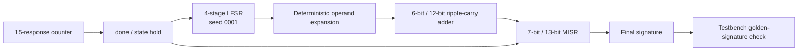

# Built-In Speed Grading for BIST Adders

Verilog implementations of 6-bit and 12-bit unsigned adders with a reusable
LFSR pattern generator and MISR response compactor, plus a historical
synthesis-and-simulation clock sweep.

以 LFSR 與 MISR 實作加法器內建自我測試，並透過時脈掃描探索速度界限。
本專案保留原始設計、作業規格與報告，附上可重跑的 RTL 驗證。

Developed for National Tsing Hua University, EE-6250 VLSI Testing,
Homework 3, Option 2 (2026). [Original report](docs/report/BISG_Adder_Report.pdf)
and [assignment specification](docs/spec/homework.3.Option2.2026.pdf).

## Design features

- **Shared BIST core:** two wrappers select a 6-bit or 12-bit circuit under test.
- **Compact pattern generation:** a four-stage LFSR visits all 15 nonzero states;
  deterministic expansion drives both complete adder operands.
- **Explicit ripple-carry logic:** propagate/generate equations produce the full
  unsigned sum, including carry-out.
- **MISR response compaction:** 7-bit and 13-bit signatures summarize 15 results;
  `done` freezes the final state until active-high asynchronous reset.
- **Speed exploration:** the original flow sweeps periods in 100 ps steps,
  resynthesizing for each candidate and checking the final signature and
  simulation timing diagnostics.

The hardware exports a signature and completion flag. Golden-signature comparison
and clock-period search run in the testbench and host scripts.

## Architecture



See [architecture](docs/ARCHITECTURE.md) for mappings, feedback equations and
completion timing. Only the 6-bit and 12-bit BIST configurations are supported.

## Performance and verification

The **original report** records these best passing clock candidates:

| Adder | Golden signature | Best reported period | Equivalent frequency | Next faster failure |
| --- | --- | ---: | ---: | ---: |
| 6-bit | `0x4d` | 800 ps | 1,250 MHz | 700 ps |
| 12-bit | `0x458` | 1,000 ps | 1,000 MHz | 900 ps |

Each candidate used a separately synthesized implementation. These are
historically reported synthesis/simulation results, rather than a newly measured
fixed-netlist Fmax. The supplied snapshot lacks the raw timing logs, netlists,
SDF files and synthesis Tcl needed to reproduce the sweep.

Fresh **RTL verification on 2026-11-11 (Asia/Taipei)** passed:

| Test | Result |
| --- | --- |
| Pure 6-bit adder | All 7 directed arithmetic comparisons pass |
| 6-bit BIST at 10,000 ps stimulus period | `done=1`, signature `0x4d` |
| 12-bit BIST at 10,000 ps stimulus period | `done=1`, signature `0x458` |

[Fresh results](docs/evidence/release/results.tsv),
[tested source hashes](docs/evidence/release/run.json), and
[performance details](docs/PERFORMANCE.md) record the evidence and its limits.
RTL simulation does not establish gate timing. Fifteen correlated operand pairs
and a matching signature do not establish exhaustive fault coverage.

## Run locally

Requires Python 3.6 or newer, `make`, and licensed Synopsys VCS.
No standard-cell or DesignWare library is required for the RTL tests.

```bash
make check
module load vcs/2025.06  # Or load your site's licensed VCS environment.
make test
```

The runner executes all three original testbenches and checks result markers,
comparison counts and golden signatures. Generated binaries, logs and VCD files
stay under the ignored `.build/` directory.

## Repository layout

```text
src/bist_adder.v          Original design RTL, unchanged
tests/original/          Three original testbenches
scripts/run_tests.py     Runnable RTL regression entry point
scripts/check_project.py Source preservation and documentation checks
scripts/original/        Historical synthesis/gate/sweep scripts
docs/spec/              Assignment specification
docs/report/            Original project report
docs/evidence/release/   Fresh RTL results and logs
```

The historical gate flow is archived as reference; see its
[prerequisites and limitations](scripts/original/README.md).
[Provenance](docs/PROVENANCE.md) records all original file identities and attribution.
