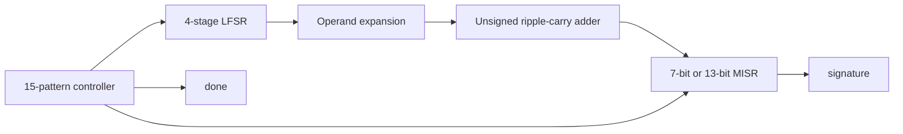

# Architecture

The design combines a deterministic built-in self-test (BIST) sequence with an unsigned ripple-carry adder. Clock-candidate exploration and signature comparison run outside the synthesizable design, in the testbenches and historical scripts.



## Supported configurations

[src/bist_adder.v](../src/bist_adder.v) defines `bist_adder6` and `bist_adder12`, which instantiate the shared `bist_adder` core. Only operand widths 6 and 12 are supported by its operand-expansion and MISR configuration. The separate `ripple_adder` module implements the combinational arithmetic.

| Operand width | Sum/MISR width | Golden signature | MISR polynomial |
| --- | --- | --- | --- |
| 6 | 7 | `0x4d` | x⁷ + x + 1 |
| 12 | 13 | `0x458` | x¹³ + x⁴ + x³ + x + 1 |

The ports expose the LFSR state, both operands, sum, signature, pattern count, and completion flag for observation.

## Pattern generation and arithmetic

Let `s` be the four-bit LFSR state. Reset seeds it to `0001`; each capture advances it using:

```text
next_s = {s[2:0], s[3] XOR s[0]}
```

The sequence visits all 15 nonzero states before repeating. Each state expands into one operand pair using Verilog concatenation:

```verilog
// 6-bit operands
a = {s, s[3:2]};
b = {s[1:0], s};

// 12-bit operands
a = {s, (s ^ 4'b1011), {s[1:0], s[3:2]}};
b = {{s[0], s[3:1]}, s, ~s};
```

For each bit `i`, the adder computes:

```text
p[i]       = a[i] XOR b[i]
g[i]       = a[i] AND b[i]
sum[i]     = p[i] XOR carry[i]
carry[i+1] = g[i] OR (p[i] AND carry[i])
carry[0]   = 0
sum[N]     = carry[N]
```

The extra sum bit preserves the unsigned carry-out.

## Response compaction and completion

For signature width `W=N+1`, the MISR update is:

```text
next_signature = ((signature << 1) truncated to W bits)
                 XOR (signature[W-1] ? tap_mask : 0)
                 XOR sum
```

The tap masks are `7'h03` and `13'h01b`. An active-high asynchronous reset sets the signature and count to zero, clears `done`, and initializes the LFSR. On each rising edge after reset, the core captures the response for the current LFSR state and advances the state. On the 15th capture, the count becomes 15 and `done` becomes high. All sequential state then holds until reset.

The original testbenches can print `cycles=16` for this 15-capture operation. Their loop checks `done` immediately after a rising-edge event, before the DUT's nonblocking assignments take effect. It consequently waits one additional edge to observe completion. That edge does not capture another response, because `done` is already high in the DUT. The final signature is checked on a falling edge.

## Verification scope

The original testbenches in [tests/original](../tests/original) check seven selected pure-adder cases and the two final signatures. BIST testbenches default to a 10000 ps clock period and release reset on a falling edge.

The BIST sequence contains 15 correlated operand pairs. No fault-injection campaign or fault-coverage measurement is supplied, and signature compaction can alias different response sequences. The design therefore demonstrates pattern generation and response compaction; it does not establish exhaustive arithmetic coverage, complete fault detection, or autonomous on-chip speed grading.
